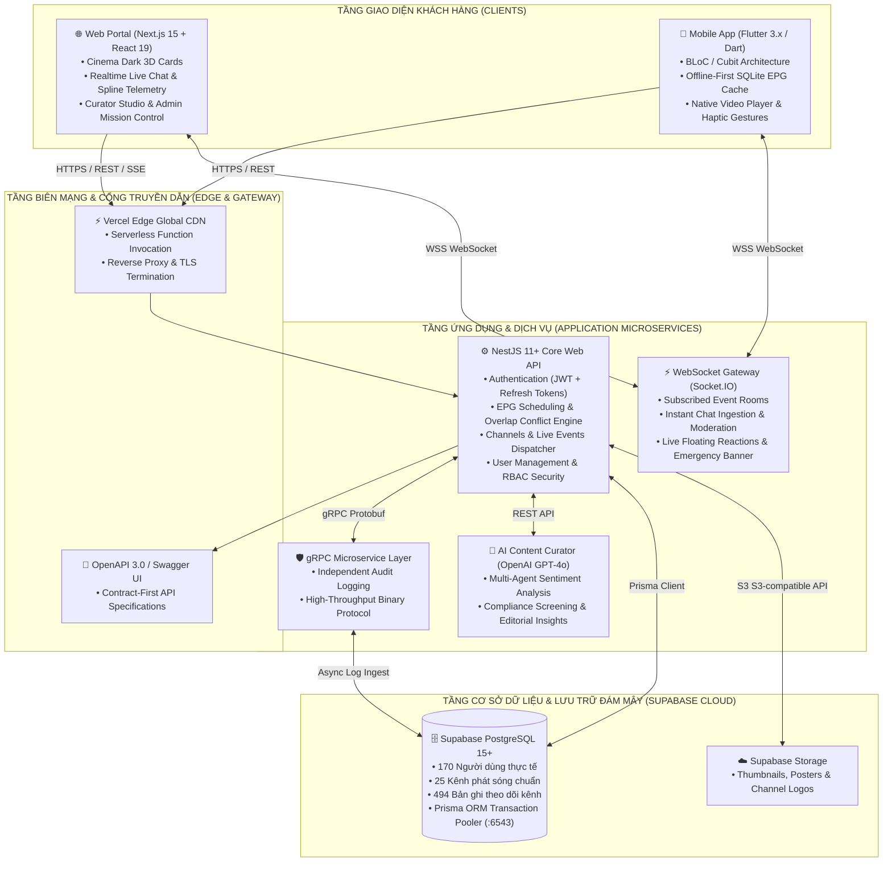
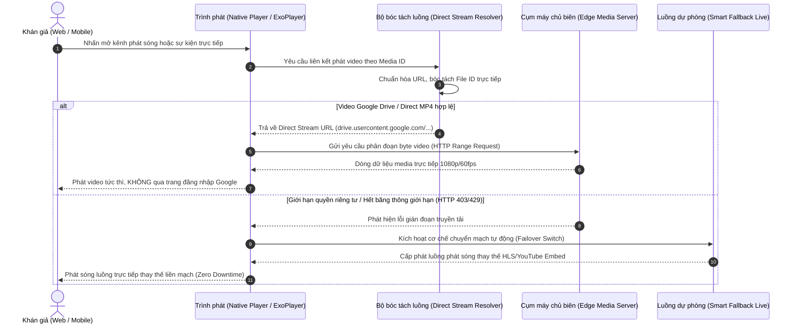
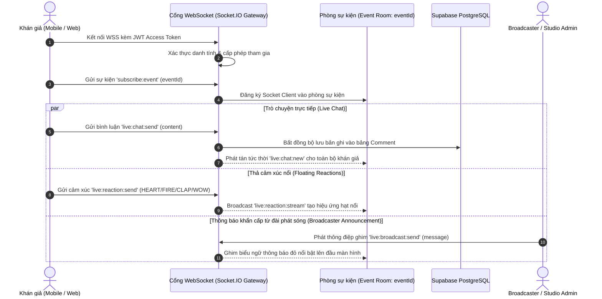
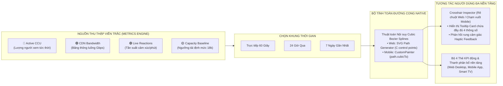
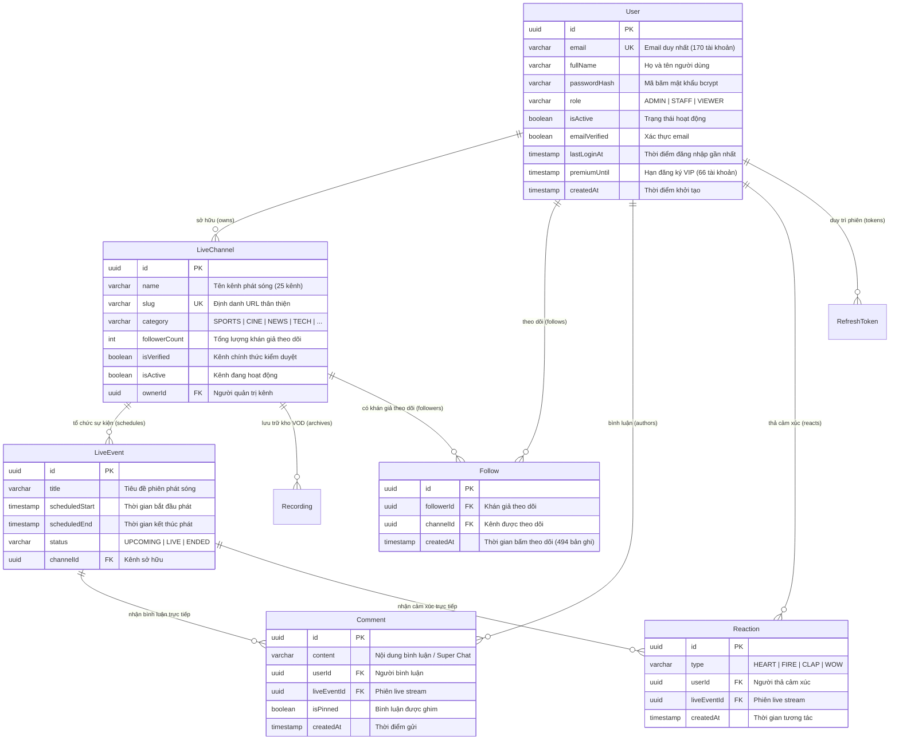
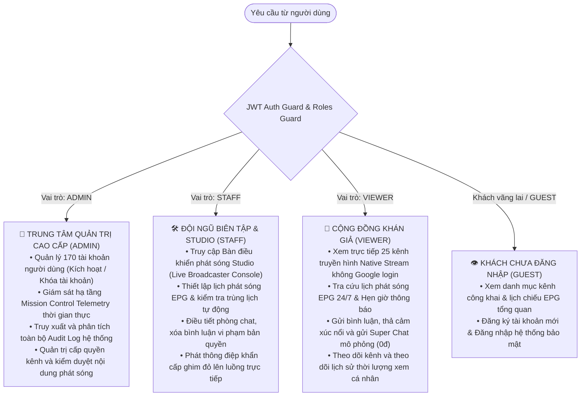

# 📡 OmniCast — Enterprise Media & Broadcast Intelligence Network

> **Dự án tích hợp môn học: PRN232 (Web API Core & Kiến trúc vi dịch vụ nâng cao) & PRM393 (Lập trình ứng dụng di động Flutter)**  
> **Học kỳ:** FA26 — Trường Đại học FPT (FPT University)  
> **Phiên bản phát hành:** `v1.2.0` (Production Release)

<p align="center">
  
  
  
  
  
  
  
  
  
  
  
  
</p>

---

## 🌟 Tổng Quan Hệ Thống

**OmniCast** là nền tảng truyền hình số và phân phối nội dung đa phương tiện thế hệ mới (**Hybrid OTT / IPTV / FAST — Free Ad-supported Streaming TV**), kết hợp sức mạnh xử lý thời gian thực giữa **Web Studio (Next.js 15 / React 19)**, **Ứng dụng di động (Flutter Mobile App)** và **Cụm Backend Microservices (NestJS 11 + Prisma ORM + gRPC)** trên nền tảng đám mây **Supabase Cloud PostgreSQL**.

Hệ thống được thiết kế theo chuẩn doanh nghiệp phát thanh - truyền hình, giải quyết triệt để các bài toán:
- **Tự động hóa chống xung đột lịch phát sóng EPG (Airtime Collision Prevention)**.
- **Phát trực tiếp đa kênh Native Video Player** triệt tiêu hoàn toàn màn hình đăng nhập tài khoản Google Drive.
- **Tương tác hai chiều siêu tốc (Zero-Latency Realtime Chat & Floating Reactions)** qua WebSocket / Socket.IO.
- **Hệ sinh thái Live Donation & Super Chat mô phỏng (Sandbox Mock Gateway)** với 6 gói quà ảo biểu trưng, cam kết 100% an toàn học tập không mất tiền thật.
- **Bảng điều khiển Telemetry đa sóng Spline Bezier** (Active CCU, CDN Bandwidth, Live Reactions, Capacity Baseline) tra cứu tương tác cảm ứng haptic trên cả Web và Mobile.

---

## 🔗 Liên Kết Triển Khai & Bản Cài Đặt (Release Assets)

| Thành Phần | Dịch Vụ / Nền Tảng | Liên Kết / Điểm Truy Cập |
| :--- | :--- | :--- |
| 🌐 **Frontend Web Portal** | Vercel Live Production | [https://omnicast-fe.vercel.app](https://omnicast-fe.vercel.app) |
| ⚙️ **Backend Web API & Swagger** | Vercel API Core | [https://omnicast-api.vercel.app/swagger](https://omnicast-api.vercel.app/swagger) |
| 🗄️ **Cơ Sở Dữ Liệu & Storage** | Supabase PostgreSQL 15 | [Supabase Console](https://supabase.com/dashboard/project/tktexqtqfnlfynbytjpw) *(Seoul Region Pooler)* |
| 📦 **GitHub Release v1.2.0** | GitHub Releases | [Release v1.2.0 Tag](https://github.com/TomOutfit/OmniCast_PRN232-PRM393_Project_Fa26Semester/releases/tag/v1.2.0) |
| 📱 **Bản cài APK ARM64 (Khuyên dùng)** | Android Smartphone | [Tải `app-arm64-v8a-release.apk` (41.0 MB)](https://github.com/TomOutfit/OmniCast_PRN232-PRM393_Project_Fa26Semester/releases/download/v1.2.0/app-arm64-v8a-release.apk) |
| 📱 **Bản cài APK ARMv7** | Android 32-bit | [Tải `app-armeabi-v7a-release.apk` (34.4 MB)](https://github.com/TomOutfit/OmniCast_PRN232-PRM393_Project_Fa26Semester/releases/download/v1.2.0/app-armeabi-v7a-release.apk) |
| 💻 **Bản cài APK x86_64** | Giả lập PC / Emulator | [Tải `app-x86_64-release.apk` (43.7 MB)](https://github.com/TomOutfit/OmniCast_PRN232-PRM393_Project_Fa26Semester/releases/download/v1.2.0/app-x86_64-release.apk) |
| 📑 **Báo Cáo Kỹ Thuật Dự Án (PDF)** | Báo Cáo Kỹ Thuật Đồ Án | [Tải `OmniCast_Comprehensive_Project_Report.pdf` (1.3 MB)](https://github.com/TomOutfit/OmniCast_PRN232-PRM393_Project_Fa26Semester/releases/download/v1.2.0/OmniCast_Comprehensive_Project_Report.pdf) |

---

## 🏛️ Sơ Đồ Kiến Trúc Hệ Thống (Architecture Flowcharts)

### 1. Kiến Trúc Tổng Thể Đa Tầng (End-to-End Enterprise Architecture)



---

### 2. Luồng Phát Trực Tiếp Video & Cơ Chế Dự Phòng (Smart Fallback Pipeline)

Khắc phục triệt để lỗi chuyển hướng HTTP 302 sang trang đăng nhập tài khoản Google (`accounts.google.com`).



---

### 3. Luồng Tương Tác Hai Chiều Thời Gian Thực (WebSocket Realtime Feed)



---

### 4. Luồng Ủng Hộ Live Stream & Super Chat Mô Phỏng (Sandbox Mock Gateway)

> 🛡️ **Cam kết an toàn tuyệt đối:** Tính năng được xây dựng phục vụ nghiên cứu và trải nghiệm đồ án môn học (Fa26Semester). Mọi giao dịch qua MoMo, VNPay QR, ZaloPay và Thẻ ATM/Visa đều là **giả lập (Mock Gateway) với chi phí thực tế = 0 ₫**, không thu thập thẻ và không bao giờ trừ tiền thật từ tài khoản ngân hàng của người dùng.

```mermaid
flowchart TD
    Start([Khán giả nhấn nút ỦNG HỘ STREAMER]) --> OpenModal[Mở hộp thoại Live Donation & Super Chat]
    
    OpenModal --> Notice[Hiển thị Huy hiệu Bảo vệ: CHẾ ĐỘ MÔ PHỎNG 0đ]
    Notice --> SelectTier[Chọn 1 trong 6 gói quà ảo:<br/>☕ Cà phê 10k | 🧋 Trà sữa 20k | 🍕 Pizza 50k<br/>🎆 Pháo hoa 100k | 🚀 Tên lửa 200k | 💎 Kim cương 500k]
    
    SelectTier --> SelectPayment[Chọn cổng thanh toán giả lập:<br/>• Ví MoMo (Sandbox 0đ)<br/>• VNPay QR (Mô phỏng 0đ)<br/>• ZaloPay (Sandbox 0đ)<br/>• Thẻ ATM / Visa (Giả lập 0đ)]
    
    SelectPayment --> InputMessage[Nhập tên hiển thị & Lời nhắn Super Chat]
    InputMessage --> CostCard[Bảng kê đối soát chi phí:<br/>• Số tiền hiển thị: Đã chọn<br/>• Chi phí thực tế bị trừ: 0 ₫ Không mất tiền]
    
    CostCard --> ConfirmClick{Nhấn XÁC NHẬN GỬI MÔ PHỎNG}
    
    ConfirmClick --> MockProcess[Xử lý giao dịch Mock Gateway<br/>• Tạo mã Token giả lập an toàn<br/>• Tự động phê duyệt trong 800ms]
    
    MockProcess --> EmitChat[Gửi tin nhắn Super Chat ghim nổi bật qua WebSocket]
    EmitChat --> ParticleFX[Kích hoạt hiệu ứng hạt ánh sáng ăn mừng rực rỡ]
    ParticleFX --> PinCard[Ghim Thẻ Super Chat đổi màu gradient theo mức quà tặng]
    PinCard --> ToastAlert[Hiển thị thông báo Toast: Ủng hộ thành công 0đ thực tế]
    ToastAlert --> End([Hoàn tất phiên tương tác an toàn])
```

---

### 5. Luồng Bảng Điều Khiển Telemetry Đa Chiều (Spline Bezier Crosshair Engine)



---

### 6. Sơ Đồ Thực Thể Cơ Sở Dữ Liệu (Database Entity-Relationship Model)



---

### 7. Ma Trận Phân Quyền Vai Trò (Role-Based Access Control — RBAC)



---

## 👥 Thành Viên Nhóm Phát Triển (Team Members)

Dự án được phân bổ cân bằng và chuyên nghiệp giữa 4 thành viên theo đúng định hướng kỹ thuật môn học **PRN232** & **PRM393**:

| Thành Viên | MSSV | Tài Khoản GitHub | Vai Trò & Trách Nhiệm Chính | Phân Hệ Phụ Trách |
| :--- | :---: | :--- | :--- | :--- |
| **Trần Thanh Sơn** | **QE170080** | [`TranThanhSonQE170080`](https://github.com/TranThanhSonQE170080) | **DevOps & Database Administrator**<br/>• Thiết kế cơ sở dữ liệu Supabase PostgreSQL & Prisma ORM<br/>• Xây dựng script mở rộng dữ liệu 170 người dùng & 494 follows<br/>• Tự động hóa CI/CD, biên dịch báo cáo kỹ thuật dự án PDF<br/>• Kiểm thử hiệu năng truy vấn và bảo mật cơ sở dữ liệu | **Database & DevOps (PRN232)** |
| **Nguyễn Vĩnh Phú** | **QE180136** | [`phunvqe180136`](https://github.com/phunvqe180136) | **Mobile Lead Developer**<br/>• Phát triển ứng dụng Flutter theo mô hình BLoC / Cubit<br/>• Xây dựng bộ CustomPainter Cubic Bezier Telemetry đa sóng<br/>• Tích hợp luồng Live Donate & Super Chat kèm rung Haptic<br/>• Đóng gói và tối ưu hóa bản dựng Android Release APK | **Mobile App (PRM393)** |
| **Nguyễn Bình An** | — | [`TomOutfit`](https://github.com/TomOutfit) | **Team Leader / Core Architect**<br/>• Thiết kế kiến trúc tổng thể, mô hình bảo mật JWT & RBAC<br/>• Xây dựng luồng Direct Stream triệt tiêu Google Login Screen<br/>• Quản lý phát hành GitHub Release & Điều phối chung | **Backend API & Web Security** |
| **Đồng Hoàng Nguyên** | — | [`teng122`](https://github.com/teng122) | **Full-Stack & Realtime Engineer**<br/>• Xây dựng giao diện Next.js 15 Cinema Dark UI & SVG Charts<br/>• Phát triển hạ tầng WebSocket tương tác thời gian thực siêu tốc<br/>• Tích hợp trợ lý thẩm định AI Curator (OpenAI GPT-4o)<br/>• Tối ưu hóa bảng điều khiển Admin Mission Control | **Full-Stack & AI (PRN232)** |

---

## 🛠️ Hướng Dẫn Cài Đặt & Chạy Cục Bộ (Local Setup Guide)

### Yêu Cầu Môi Trường (Prerequisites)
- **Node.js**: Phiên bản `18.x` hoặc `20.x+` (Khuyên dùng `v20` hoặc `v24`).
- **Flutter SDK**: Phiên bản `3.x` (kênh stable).
- **PostgreSQL / Supabase**: Tài khoản hoặc chuỗi kết nối PostgreSQL Supabase đã cấu hình.

---

### 1. Khởi Chạy Backend Web API (NestJS)

```bash
# 1. Di chuyển vào thư mục backend
cd backend

# 2. Cài đặt các thư viện phụ thuộc
npm install

# 3. Đồng bộ schema Prisma và sinh Prisma Client
npx prisma generate

# 4. (Tùy chọn) Chạy script mở rộng dữ liệu 170 người dùng lên Supabase
npm run db:seed:users

# 5. Khởi động máy chủ backend ở chế độ phát triển
npm run start:dev
```
> API và tài liệu tương tác Swagger sẽ khởi chạy tại: `http://localhost:3000/swagger`

---

### 2. Khởi Chạy Frontend Web Portal (Next.js)

```bash
# 1. Di chuyển vào thư mục frontend
cd frontend

# 2. Cài đặt các gói npm
npm install

# 3. Kiểm tra kiểu dữ liệu TypeScript (0 lỗi)
npm run type-check

# 4. Khởi chạy máy chủ giao diện Next.js
npm run dev
```
> Cổng giao diện Web Portal sẽ hoạt động tại: `http://localhost:3001`

---

### 3. Khởi Chạy Ứng Dụng Di Động (Flutter Mobile App)

```bash
# 1. Di chuyển vào thư mục mobile
cd mobile

# 2. Tải các gói thư viện Dart / Flutter
flutter pub get

# 3. Kiểm tra mã nguồn tĩnh (Zero analysis issues)
flutter analyze

# 4. Chạy ứng dụng trên thiết bị Android thật hoặc máy ảo
flutter run

# 5. Hoặc biên dịch gói cài đặt Release APK cho điện thoại
flutter build apk --release --split-per-abi
```

---

## 📜 Giấy Phép & Bản Quyền (License)

Dự án được xây dựng và công bố theo giấy phép mã nguồn mở **MIT License**.  
Bản quyền thuộc về **Đội ngũ Phát triển Dự án OmniCast (FA26 Semester — FPT University)**.
