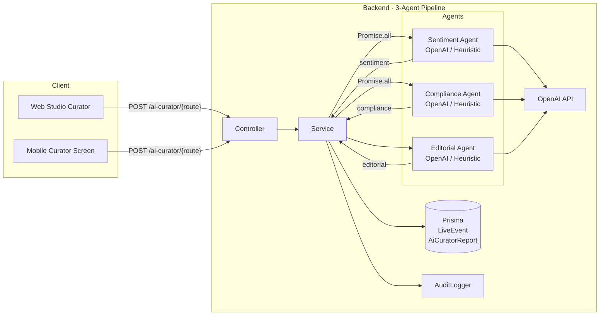

# OmniCast — AI Curator Studio

> **Owner:** OmniCast PRN232 (AI Content Curation)  
> **Stack:** NestJS (Backend) · Next.js (Web Studio) · Flutter (Mobile Studio)  
> **RBAC:** `STAFF` · `ADMIN` only

---

## Architecture



### Agent breakdown

| Agent | Input | Output | Fallback |
|-------|-------|--------|----------|
| **Sentiment Agent** | title, description, channel, tags | `overallSentiment` · `hypeLevel` · `audienceEngagement` (0–100) | Heuristic regex on Vietnamese keywords |
| **Compliance Agent** | title, description, category, tags | `isAgeRestricted` · `ageRating` (PG/T13/T16/T18) · `flaggedContent[]` · `recommendedBroadcastWindow` (DAY/EVENING/LATE_NIGHT) | Keyword flagging (violence → T16, explicit → T18) |
| **Editorial Agent** | program fields + sentiment + compliance | `broadcastSuitability` (PRIME_TIME/STANDARD/RESTRICTED) · `suggestedTimeSlot` · `targetAudienceVibe` · `riskWarnings` | Tiered logic based on hype + age restriction flags |

**Per-agent timings** (`agentTimings`) are tracked internally and returned in the report, enabling future per-agent breakdown display.

---

## API Reference

Base URL: `/v1/ai-curator`  
Authentication: `Bearer <JWT>` (role `STAFF` or `ADMIN` required)

---

### 1. Preview / Ad-hoc Analysis

**Mode 2** — Analyze raw program fields without saving first. No database write.

```
POST /ai-curator/analyze
Content-Type: application/json
```

**Request body** (`AnalyzeContentPreviewDto`):

| Field | Type | Constraints | Description |
|-------|------|-------------|-------------|
| `title` | string | 3–200 chars · **required** | Programme title |
| `description` | string | max 5,000 chars · optional | Programme blurb |
| `channelName` | string | max 120 chars · optional | Display name of parent channel |
| `category` | string | max 60 chars · optional | Channel category (e.g. `SPORTS`, `MUSIC`) |
| `language` | string | ISO 639-1 · optional | Broadcast language |
| `scheduledAt` | string | ISO 8601 · optional | Planned air time (anchors editorial decision) |
| `tags` | string[] | max 10 tags · optional | Tags to enrich sentiment prompt |

**Success response** — `AiCuratorReport` (preview mode, never persisted):

```json
{
  "broadcastSuitability": "PRIME_TIME",
  "suggestedTimeSlot": "21:00 - 23:00",
  "targetAudienceVibe": "Khán giả đại chúng theo dõi sự kiện lớn",
  "riskWarnings": "Phù hợp mọi đối tượng",
  "sentimentAnalysis": {
    "overallSentiment": "positive",
    "hypeLevel": "high",
    "audienceEngagement": 80
  },
  "complianceAssessment": {
    "isAgeRestricted": false,
    "ageRating": "PG",
    "flaggedContent": [],
    "recommendedBroadcastWindow": "EVENING"
  },
  "aiModelVersion": "gpt-4o-omnicast-v3",
  "processingTimeMs": 1340,
  "tokenUsed": 892,
  "agentTimings": {
    "sentimentMs": 340,
    "complianceMs": 310,
    "editorialMs": 690
  }
}
```

**Rate limit:** 20 req/min per user (shared throttle group)

**curl example:**
```bash
curl -X POST http://localhost:3000/v1/ai-curator/analyze \
  -H "Authorization: Bearer $TOKEN" \
  -H "Content-Type: application/json" \
  -d '{
    "title": "Chung kết World Cup 2026",
    "description": "Trực tiếp trận chung kết giải bóng đá lớn nhất hành tinh",
    "channelName": "VTV3 HD",
    "category": "SPORTS",
    "tags": ["thể thao", "world cup", "live"]
  }'
```

---

### 2. Curate Existing Program (Persist)

**Mode 1** — Look up a saved `LiveEvent` in the database, run the full pipeline, persist the report.

```
POST /ai-curator/curate
Content-Type: application/json
```

**Request body** (`CurateContentDto`):

| Field | Type | Description |
|-------|------|-------------|
| `programId` | string · **required** | UUID of an existing `LiveEvent` |
| `forceRefresh` | boolean · optional | If `false` (default) and a cached report exists, return it with `cached: true` without re-running the model |

**Response** — `AiCuratorHistoryItem` (same shape as preview + DB metadata):

```json
{
  "id": "rpt-uuid",
  "programId": "evt-uuid",
  "broadcastSuitability": "PRIME_TIME",
  "suggestedTimeSlot": "21:00 - 23:00",
  "targetAudienceVibe": "Khán giả đại chúng theo dõi sự kiện lớn",
  "riskWarnings": "Phù hợp mọi đối tượng",
  "sentimentAnalysis": { ... },
  "complianceAssessment": { ... },
  "aiModelVersion": "gpt-4o-omnicast-v3",
  "processingTimeMs": 1340,
  "tokenUsed": 892,
  "agentTimings": { "sentimentMs": 340, "complianceMs": 310, "editorialMs": 690 },
  "cached": false,
  "createdBy": "user-uuid",
  "createdAt": "2026-10-15T04:30:00.000Z"
}
```

**Rate limit:** 30 req/min per user  
**Status codes:** `200 OK` · `400 BadRequest` · `401 Unauthorized` · `403 Forbidden` · `404 NotFound` · `429 TooManyRequests`

**curl example:**
```bash
curl -X POST http://localhost:3000/v1/ai-curator/curate \
  -H "Authorization: Bearer $TOKEN" \
  -H "Content-Type: application/json" \
  -d '{ "programId": "evt-abc123", "forceRefresh": true }'
```

---

### 3. Apply AI Suggestions

**Mode 3** — Push selected AI suggestions back to the program. Only fields present in the payload are written.

```
POST /ai-curator/apply/:programId
Content-Type: application/json
```

**Path param:** `programId` — UUID of the `LiveEvent`

**Request body** (`ApplyCurationDto`):

| Field | Type | Description |
|-------|------|-------------|
| `scheduledAt` | ISO 8601 · optional | Override air time with AI-suggested slot |
| `status` | string · optional | Set program status (e.g. `SCHEDULED → LIVE`) |
| `description` | string · optional | Replace description with curator-improved blurb |
| `markApplied` | boolean · optional | If `true` (default), set `lastAppliedAt` on the program + write `AI_CURATION_APPLIED` audit entry |

**Response:**

```json
{
  "programId": "evt-abc123",
  "appliedFields": ["scheduledAt", "description"],
  "updatedAt": "2026-10-15T04:35:00.000Z",
  "channel": { "id": "ch-uuid", "name": "VTV3 HD" }
}
```

**Rate limit:** 30 req/min per user  
**Status codes:** `200 OK` · `400 BadRequest` · `401 Unauthorized` · `403 Forbidden` · `404 NotFound` · `429 TooManyRequests`

---

### 4. Curation History

```
GET /ai-curator/history/:programId
```

**Path param:** `programId` — UUID of the `LiveEvent`  
**Response:** Array of up to 10 most recent `AiCuratorHistoryItem` rows, newest first.

```json
[
  {
    "id": "rpt-uuid-2",
    "programId": "evt-abc123",
    "broadcastSuitability": "PRIME_TIME",
    "suggestedTimeSlot": "21:00 - 23:00",
    "aiModelVersion": "heuristic-fallback-v1",
    "processingTimeMs": 12,
    "tokenUsed": null,
    "cached": false,
    "createdBy": "user-uuid",
    "createdAt": "2026-10-15T04:30:00.000Z"
  }
]
```

---

## Response Shapes

### `AiCuratorReport` (all modes)

| Field | Type | Description |
|-------|------|-------------|
| `broadcastSuitability` | `PRIME_TIME \| STANDARD \| RESTRICTED` | Editorial tier |
| `suggestedTimeSlot` | string | Format: `"HH:MM - HH:MM"` |
| `targetAudienceVibe` | string | Free-text audience description |
| `riskWarnings` | string | Viewer advisories |
| `sentimentAnalysis` | object | See below |
| `complianceAssessment` | object | See below |
| `aiModelVersion` | string | `"gpt-4o-omnicast-v3"` or `"heuristic-fallback-v1"` |
| `processingTimeMs` | number | Total pipeline wall-clock time |
| `tokenUsed` | number \| null | OpenAI token count (null on heuristic) |
| `agentTimings` | object | Per-agent breakdown: `{ sentimentMs, complianceMs, editorialMs }` |
| `cached` | boolean | `true` when returned from cache without re-running model |

### `sentimentAnalysis`

```ts
{
  overallSentiment: 'positive' | 'neutral' | 'negative';
  hypeLevel: 'low' | 'medium' | 'high';
  audienceEngagement: number; // 0–100
}
```

### `complianceAssessment`

```ts
{
  isAgeRestricted: boolean;
  ageRating: 'PG' | 'T13' | 'T16' | 'T18';
  flaggedContent: string[]; // e.g. ['violence', 'explicit-language']
  recommendedBroadcastWindow: 'DAY' | 'EVENING' | 'LATE_NIGHT';
}
```

---

## Caching Strategy

The **first** call to `POST /curate` for a program (without `forceRefresh`) always runs the pipeline and stores the result.

Subsequent calls (without `forceRefresh`) return the most-recent persisted report with `cached: true` — **no re-run**. The curator can force a fresh run by passing `forceRefresh: true`.

Preview mode (`POST /analyze`) **never** touches the database and always returns `cached: false` with no `id` / `programId`.

---

## Fallback Chain

```
Has OPENAI_API_KEY?
├─ YES → GPT-4o (gpt-4o-omnicast-v3)
│         └─ Network / API error?
│             └─ YES → Heuristic fallback
└─ NO  → Heuristic fallback (heuristic-fallback-v1)
```

Heuristic rules are keyword-based (Vietnamese + English) and cover:
- **Sentiment:** `tuyệt/vip/champion/best/love → positive`; `buồn/bi kịch/sad/tragic → negative`
- **Compliance:** `bạo lực/kill/violence/chết → violence flag + T16`; `ngôn ngữ/khiêu dâm/18+ → explicit-language flag + T18`
- **Editorial:** High hype + no restriction → PRIME_TIME; any restriction → RESTRICTED; else STANDARD

---

## Rate Limits

| Endpoint | Limit | Scope |
|----------|-------|-------|
| `POST /ai-curator/analyze` | 20 req/min | per user |
| `POST /ai-curator/curate` | 30 req/min | per user |
| `POST /ai-curator/analyze/:programId` | 30 req/min | per user |
| `POST /ai-curator/apply/:programId` | 30 req/min | per user |
| `GET /ai-curator/history/:programId` | no throttle | — |

Exceeded limit → `429 TooManyRequests` with `Retry-After` header.

---

## RBAC

All 5 endpoints require a valid JWT with `role` claim of `STAFF` (1) or `ADMIN` (3). `JwtAuthGuard` validates the token; `RolesGuard` enforces the role. Missing or invalid JWT → `401 Unauthorized`; insufficient role → `403 Forbidden`.

---

## Deployment

### Environment Variables

| Variable | Required | Description |
|----------|----------|-------------|
| `OPENAI_API_KEY` | Recommended | GPT-4o access. If absent or `"dummy-key"`, the heuristic fallback is used automatically. |
| `JWT_SECRET` | Yes | Secret for JWT verification |
| `DATABASE_URL` | Yes | Prisma-compatible PostgreSQL URL |

### Prisma Schema requirements

```prisma
model LiveEvent {
  // ... existing fields
  lastAppliedAt        DateTime?
  lastAppliedReportId String?
}

model AiCuratorReport {
  id                   String   @id @default(uuid())
  programId            String
  broadcastSuitability String
  suggestedTimeSlot    String
  targetAudienceVibe   String
  riskWarnings         String
  sentimentAnalysis    Json
  complianceAssessment Json
  aiModelVersion       String
  tokenUsed            Int?
  processingTimeMs     Int
  createdBy            String?
  createdAt            DateTime @default(now())
}
```

### Running the pipeline locally

```bash
# Install dependencies
cd backend && npm install

# Run unit tests (16 total)
npm test

# Start dev server
npm run start:dev
```

---

## Frontend (Web Studio)

**URL:** `/studio/curator`  
**Page:** `frontend/app/studio/curator/page.tsx`  
**Components:** `ReportDetail`, `ApplyCurationPanel`, `CurateActions`, `HistorySection`  
**Hooks:** `useAnalyzeContent`, `useCurateProgram`, `useApplyCuration`, `useCurationHistory`  
**API client:** `frontend/lib/api/ai-curator.ts`  
**Helpers:** `frontend/lib/utils/curator-helpers.ts` (`parseSuggestedTime`, `truncate`, `toReportShape`)  
**i18n:** `frontend/lib/i18n/en.json` + `vi.json` (`curator` section, 41 keys)  
**Tests:** `curator-helpers.test.ts` (13 cases) · `useAiCurator.test.ts` (11 cases)

---

## Mobile (Flutter Studio)

**Route:** `/studio/curator`  
**Screen:** `mobile/lib/presentation/screens/studio/ai_curator_screen.dart`  
**Repository:** `mobile/lib/data/repositories/ai_curator_repository.dart`  
**i18n:** `mobile/lib/core/i18n/strings.dart` (~60 `curator.*` keys, Vietnamese + English)  
**Tests:** `mobile/test/data/repositories/ai_curator_repository_test.dart` (23 cases)

---

## Changelog

| Date | Change |
|------|--------|
| 2026-10-15 | Added `agentTimings` to `AiCuratorReport` for per-agent breakdown |
| 2026-10-15 | Fixed `getCurationHistory` returning `cached` field as absent |
| 2026-10-15 | Fixed `applyCuration` ignoring `markApplied` flag (`lastAppliedAt` now set) |
| 2026-10-15 | Added `@Throttle` (30/min) to `/curate`, `/analyze/:programId`, `/apply/:programId` |
| 2026-10-15 | Added unit tests for service (3 new), hooks (11), helpers (13), repository (23) |
| 2026-10-15 | Added i18n support for web (41 keys) and mobile (~60 keys) |
