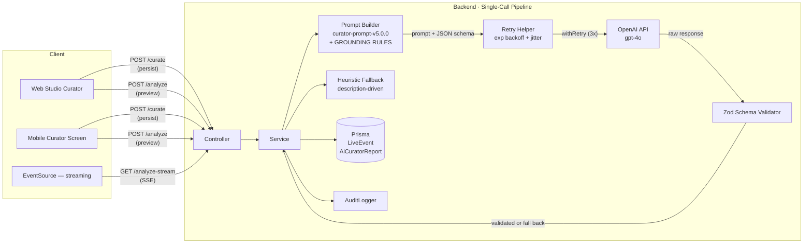

# OmniCast — AI Curator Studio

> **Owner:** OmniCast PRN232 (AI Content Curation)  
> **Stack:** NestJS (Backend) · Next.js (Web Studio) · Flutter (Mobile Studio)  
> **RBAC:** `STAFF` · `ADMIN` only  
> **Current model:** `gpt-4o-omnicast-v3` · **Current prompt:** `curator-prompt-v5.0.0` (consolidated single-call + grounding)

---

## Architecture (2026-10-19 refactor)

The AI Curator was overhauled on 2026-10-19 to address cost, latency, and
stability. The 3-agent pipeline (sentiment + compliance + editorial) was
collapsed into a **single consolidated OpenAI call** returning a structured
JSON that the service then maps onto the same `AiCuratorReport` shape used
by clients.



### What changed vs the old 3-agent design

| Aspect | Old (pre-2026-10-19) | New (2026-10-19) |
|--------|----------------------|------------------|
| **OpenAI calls per curation** | 3 (sentiment + compliance + editorial) | **1 consolidated call** |
| **Approx. token cost per call** | ~3× prompt tokens | ~1× prompt tokens |
| **Approx. wall-clock latency** | 3–6s (sentiment+compliance in parallel, editorial sequential) | 1–3s |
| **Response validation** | `JSON.parse(content)` — trusted blindly | **Zod schema** with typed `safeParse` |
| **Retry on transient errors** | None — one blip → heuristic | **Exp. backoff with jitter**, 3 attempts |
| **Prompt version tracking** | None | Stamped on every report (`promptVersion`) |
| **Streaming** | None (full wait) | **`POST /analyze-stream`** via SSE |
| **Heuristic fallback categories** | 3 (SPORTS / NEWS / MUSIC) | **7** (+ KIDS, DOC, COMEDY, TALKSHOW) |
| **Confidence formula** | `100 * exp(avgLogprob)` | Adds length bonus, retry penalty, internal-consistency check |

### Pipeline internals

1. **Prompt build** — `buildConsolidatedPrompt()` produces a single
   multi-section prompt with an inline JSON schema, scoring weights, and
   a few-shot example. Versioned via `PROMPT_VERSION` constant.
2. **OpenAI call** — Single `chat.completions.create({ response_format:
   'json_object', logprobs: true, top_p: 0.95, presence_penalty: 0.1 })`
   wrapped in `withRetry()` (3 attempts, exponential backoff with jitter,
   retries on 429 / 5xx / network errors).
3. **Zod validation** — Raw `content` is parsed and validated against
   `ConsolidatedReportSchema`. A bad response triggers a graceful
   fallback to the heuristic path and stamps `validationError` on the
   report for observability.
4. **Confidence scoring** — Combines:
   - Avg logprob of completion tokens (model "certainty")
   - Length-aware bonus (longer, more detailed completions get +0..+5)
   - Retry penalty (each retry costs 5 points)
   - Internal-consistency check (e.g. `RESTRICTED` without
     `isAgeRestricted=true` docks 10)
5. **Persistence** — `curateContent` writes the report to Prisma; the
   `confidence` field is **NOT** persisted (no DB column), only returned
   in the API response.

### Heuristic fallback

| Category | Key matches | Production format | Special handling |
|----------|-------------|-------------------|------------------|
| `SPORTS` | `thể thao`, `bóng đá`, `cup`, `trận`, `final`, `champion` | Multi-cam Live Broadcast, DYNAMIC pacing | Score boost: +14 production, +15 appeal, +10 commercial |
| `NEWS` | `tin tức`, `thời sự`, `bản tin`, `news` | Studio + field reporting, MODERATE pacing | Score boost: +15 content, +5 compliance |
| `MUSIC` / `SHOW` / `ENTERTAINMENT` | `nhạc`, `concert`, `gala`, `live show`, `âm nhạc` | Stage concert, FAST_PACED | Score boost: +12 production, +10 appeal |
| `KIDS` / `CHILDREN` | `thiếu nhi`, `trẻ em`, `kids`, `hoạt hình` | Multi-format 2D/3D animation, HIGH interactivity | +12 content, +4 compliance, COPPA-aligned |
| `DOCUMENTARY` / `DOC` | `phim tài liệu`, `tài liệu`, `documentary`, `khám phá` | Field documentary + archive footage, SLOW pacing | +16 content, HDR / Dolby 5.1 spec |
| `COMEDY` | `hài`, `hài kịch`, `truyện cười`, `stand-up` | Multi-cam studio + live audience, FAST_PACED | +12 commercial, +10 appeal |
| `TALKSHOW` | `talkshow`, `talk show`, `trò chuyện`, `phỏng vấn` | 2-4 guest conversation, MODERATE | +8 content, +5 commercial |
| _Other_ | (any) | Generic talkshow+documentary hybrid | Default weights |

---

## Grounding overhaul (prompt v5 — 2026-10-31)

Prompt v5 fixes the core complaint that "the AI report doesn't match
the program". Three things changed:

### 1. The prompt now carries the full program context

| Field | Before | After |
|-------|--------|-------|
| `Category` | hard-coded `"Chương trình"` from the web client | the real `channel.category` |
| `Tags` | dropped by the client (never sent) | sent and rendered in the prompt |
| `Language` | dropped by the client (never sent) | sent and rendered in the prompt |
| `Duration` | not sent at all | sent as seconds, rendered as `1h 30m` |

### 2. `GROUNDING RULES` block

The prompt now carries six rules that take priority over everything
else:

1. **SOURCE-ONLY** — every factual claim must be traceable to the
   program input. No invented names, numbers, dates, or guests.
2. **NO FILLER** — the bullet arrays may be *empty*. A thin
   description is allowed to produce zero highlights.
3. **DECLARE GAPS, DON'T GUESS** — missing information goes into
   `infoGaps` instead of being invented.
4. **QUOTE VERBATIM** — `sourceExcerpts` must be copied character for
   character from the description.
5. **GENERALISED JUDGEMENTS ARE ALLOWED** — editorial judgements are
   fine as long as they are phrased as judgements.
6. **HONEST NUMBERS** — a thin description scores *lower*.

The few-shot section was also replaced: the old single sports example
biased the model toward sports phrasing. v5 ships **three** examples
(news with a rich description, documentary with a medium description,
and a thin description) that demonstrate the JSON structure and the
grounding behaviour without biasing toward a genre.

### 3. The backend verifies the grounding itself

The model reports `groundingScore`, but the backend **never trusts
it**. `computeGroundingScore()` recomputes the score from the source
text on every run:

| Component | Weight | What it measures |
|-----------|--------|------------------|
| Coverage | 0–70 | Share of the description's key terms (stopwords removed) that appear in the generated content assessment |
| Citation honesty | 0–30 | Share of `sourceExcerpts` that are verbatim in the description (normalised: lowercased, diacritics stripped) |
| Source richness ceiling | cap | The score can never exceed `100 × (distinct key terms / 20)` — a one-line description caps the score low even when quoted back perfectly |
| Fabrication penalty | −12 each | Each excerpt that isn't in the source. Any fabrication also caps the score at 45 |

The recomputed score **overwrites** the model's value, and it is used
to discount the report's `confidence`:

| Grounding score | Confidence impact |
|-----------------|-------------------|
| ≥ 70 | No penalty |
| 55–69 | Mild discount (`(70 − score) × 0.5`) |
| < 55 | Up to a 20-point discount, scaled linearly |

### Grounding block (new response field)

```json
"grounding": {
  "sourceExcerpts": ["cứu hộ 8 người bị lũ quét ở Nghệ An"],
  "infoGaps": ["Không rõ tình trạng cứu hộ hiện tại"],
  "groundingScore": 88
}
```

The block is persisted inside the `sentimentAnalysis` JSON blob, so no
Prisma migration is required. Legacy rows written before v5 simply
return an empty grounding block with a score of `0`.

### Heuristic fallback now reads the description too

The old fallback returned a fixed set of template bullets chosen by
channel category — it never read the description, so a program with a
rich description got the same generic "Tường thuật trực tiếp diễn
biến kịch tính" bullet as a program with no description at all.

The fallback now **extracts** the assessment from the real description:

- `summary` → the first meaningful sentence(s)
- `highlights` → sentences carrying distinctive content (numbers,
  proper nouns, quoted names)
- `strengths` → the most information-dense sentences
- `weaknesses` → derived from the declared information gaps

When the description is too thin to support a claim, the arrays are
left **empty** rather than padded with filler.

---

## API Reference

Base URL: `/v1/ai-curator`  
Authentication: `Bearer <JWT>` (role `STAFF` or `ADMIN` required)

---

### 1. Preview / Ad-hoc Analysis (sync)

**Mode 2a** — Analyze raw program fields without saving first. No database write.

```
POST /ai-curator/analyze
Content-Type: application/json
```

**Request body** (`AnalyzeContentPreviewDto`):

| Field | Type | Constraints | Description |
|-------|------|-------------|-------------|
| `title` | string | 3–200 chars · **required** | Programme title |
| `description` | string | max 5,000 chars · optional | Programme blurb |
| `channelName` | string | max 120 chars · optional | Display name of parent channel |
| `category` | string | max 60 chars · optional | Channel category (e.g. `SPORTS`, `MUSIC`) |
| `language` | string | ISO 639-1 · optional | Broadcast language |
| `scheduledAt` | string | ISO 8601 · optional | Planned air time (anchors editorial decision) |
| `tags` | string[] | max 20 tags · optional | Tags to enrich sentiment prompt |
| `duration` | number | 0–86,400 (seconds) · optional | Program duration — used to judge pacing and pick a fitting slot |

**Success response** — `AiCuratorReport` (preview mode, never persisted):

```json
{
  "broadcastSuitability": "PRIME_TIME",
  "suggestedTimeSlot": "21:00 - 23:00",
  "targetAudienceVibe": "Khán giả đại chúng theo dõi sự kiện lớn",
  "riskWarnings": "Phù hợp mọi đối tượng",
  "sentimentAnalysis": {
    "overallSentiment": "positive",
    "hypeLevel": "high",
    "audienceEngagement": 80
  },
  "complianceAssessment": {
    "isAgeRestricted": false,
    "ageRating": "PG",
    "flaggedContent": [],
    "recommendedBroadcastWindow": "EVENING"
  },
  "contentAssessment": {
    "summary": "...",
    "highlights": ["..."],
    "strengths": ["..."],
    "weaknesses": ["..."],
    "narrativeFlow": "...",
    "targetAudienceDetails": "..."
  },
  "formatAssessment": {
    "productionFormat": "...",
    "pacing": "DYNAMIC",
    "visualAudioRequirements": ["..."],
    "interactivityLevel": "HIGH",
    "technicalRecommendations": "..."
  },
  "scoringBreakdown": {
    "contentQuality": 85,
    "productionValue": 92,
    "audienceAppeal": 95,
    "complianceSafety": 98,
    "commercialPotential": 94,
    "overallScore": 92,
    "grade": "S"
  },
  "grounding": {
    "sourceExcerpts": [
      "Trận chung kết giải bóng đá lớn nhất hành tinh"
    ],
    "infoGaps": [
      "Không rõ tên các cầu thủ tham dự"
    ],
    "groundingScore": 88
  },
  "aiModelVersion": "gpt-4o-omnicast-v3",
  "promptVersion": "curator-prompt-v5.0.0",
  "processingTimeMs": 1340,
  "pipelineMs": 1340,
  "openaiCallMs": 1180,
  "openaiRetries": 1,
  "tokenUsed": 892,
  "confidence": 87
}
```

**Rate limit:** 20 req/min per user (shared throttle group)

**curl example:**
```bash
curl -X POST http://localhost:3000/v1/ai-curator/analyze \
  -H "Authorization: Bearer $TOKEN" \
  -H "Content-Type: application/json" \
  -d '{
    "title": "Chung kết World Cup 2026",
    "description": "Trực tiếp trận chung kết giải bóng đá lớn nhất hành tinh",
    "channelName": "VTV3 HD",
    "category": "SPORTS",
    "tags": ["thể thao", "world cup", "live"]
  }'
```

---

### 1b. Preview / Ad-hoc Analysis (streaming)

**Mode 2b** — Same as `/analyze` but returns **Server-Sent Events** so
the client can render content progressively as OpenAI streams tokens.

```
GET /ai-curator/analyze-stream
Content-Type: application/json  (request body same as /analyze)
Accept: text/event-stream
```

**Wire format** (SSE — one event per line, `event:` + `data:`):

```
event: meta
data: {"type":"started","promptVersion":"curator-prompt-v5.0.0","model":"gpt-4o","startedAt":"2026-10-19T..."}

event: delta
data: {"text":"{\n  \"sentiment"}

event: delta
data: {"text":": {\n    \"overallSentiment\": \"positive\""}

event: complete
data: {"type":"complete","report":{...full AiCuratorReport...},"processingTimeMs":1340,"confidence":87,"openaiRetries":1}
```

**Error events:**

```
event: error
data: {"type":"openai-connection-failed","message":"...","retryable":true}

event: error
data: {"type":"openai-stream-failed","message":"...","partialText":"{...","retryable":false}

event: error
data: {"type":"schema-validation-failed","message":"...","retryable":true}
```

**Terminal event is always exactly one of `complete` or `error`.**

The client has two options:
1. **Recommended** — use the `complete` event's `report` field directly
2. Concatenate all `delta.text` chunks and `JSON.parse()` the result

**Browser usage:**

```js
const source = new EventSource(
  '/v1/ai-curator/analyze-stream',  // Note: EventSource is GET-only;
                                    // for POST payloads use the fetch+ReadableStream pattern
);
source.addEventListener('delta', (e) => processDelta(JSON.parse(e.data)));
source.addEventListener('complete', (e) => renderReport(JSON.parse(e.data).report));
source.addEventListener('error', (e) => handleError(JSON.parse(e.data)));
```

> ⚠️ **Browser caveat:** `EventSource` is GET-only. For POST payloads,
> use `fetch()` with `ReadableStream` body parsing, or a thin library
> like `microsoft/fetch-event-source`. The backend endpoint accepts the
> same body as `POST /analyze` (it doesn't care about the HTTP method
> for the SSE endpoint — NestJS's `@Sse()` uses GET by default; switch
> to POST in production if you need body params from a browser).

**Rate limit:** 10 req/min per user (tighter than sync because streaming
holds a server connection open).

---

### 2. Curate Existing Program (Persist)

**Mode 1** — Look up a saved `LiveEvent`, run the full pipeline, persist the report.

```
POST /ai-curator/curate
Content-Type: application/json
```

**Request body** (`CurateContentDto`):

| Field | Type | Description |
|-------|------|-------------|
| `programId` | string · **required** | UUID of an existing `LiveEvent` |
| `forceRefresh` | boolean · optional | If `false` (default) and a cached report exists, return it with `cached: true` without re-running the model |

**Response** — same shape as preview + DB metadata:

```json
{
  "id": "rpt-uuid",
  "programId": "evt-uuid",
  "broadcastSuitability": "PRIME_TIME",
  "suggestedTimeSlot": "21:00 - 23:00",
  "targetAudienceVibe": "...",
  "riskWarnings": "...",
  "sentimentAnalysis": { "...": "..." },
  "complianceAssessment": { "...": "..." },
  "contentAssessment": { "...": "..." },
  "formatAssessment": { "...": "..." },
  "scoringBreakdown": { "...": "..." },
  "aiModelVersion": "gpt-4o-omnicast-v3",
  "promptVersion": "curator-prompt-v5.0.0",
  "processingTimeMs": 1340,
  "pipelineMs": 1340,
  "openaiCallMs": 1180,
  "openaiRetries": 1,
  "tokenUsed": 892,
  "confidence": 87,
  "validationError": null,
  "cached": false,
  "createdBy": "user-uuid",
  "createdAt": "2026-10-19T..."
}
```

**Rate limit:** 30 req/min per user  
**Status codes:** `200 OK` · `400 BadRequest` · `401 Unauthorized` · `403 Forbidden` · `404 NotFound` · `429 TooManyRequests`

**curl example:**
```bash
curl -X POST http://localhost:3000/v1/ai-curator/curate \
  -H "Authorization: Bearer $TOKEN" \
  -H "Content-Type: application/json" \
  -d '{ "programId": "evt-abc123", "forceRefresh": true }'
```

---

### 3. Apply AI Suggestions

**Mode 3** — Push selected AI suggestions back to the program. Only fields present in the payload are written.

```
POST /ai-curator/apply/:programId
Content-Type: application/json
```

**Path param:** `programId` — UUID of the `LiveEvent`

**Request body** (`ApplyCurationDto`):

| Field | Type | Description |
|-------|------|-------------|
| `scheduledAt` | ISO 8601 · optional | Override air time with AI-suggested slot |
| `status` | string · optional | Set program status (e.g. `SCHEDULED → LIVE`) |
| `description` | string · optional | Replace description with curator-improved blurb |
| `markApplied` | boolean · optional | If `true` (default), set `lastAppliedAt` on the program + write `AI_CURATION_APPLIED` audit entry |

**Response:**

```json
{
  "programId": "evt-abc123",
  "appliedFields": ["scheduledAt", "description"],
  "updatedAt": "2026-10-19T...",
  "channel": { "id": "ch-uuid", "name": "VTV3 HD" }
}
```

**Rate limit:** 30 req/min per user  
**Status codes:** `200 OK` · `400 BadRequest` · `401 Unauthorized` · `403 Forbidden` · `404 NotFound` · `429 TooManyRequests`

---

### 4. Curation History

```
GET /ai-curator/history/:programId
```

**Path param:** `programId` — UUID of the `LiveEvent`  
**Response:** Array of up to 10 most recent `AiCuratorHistoryItem` rows, newest first.

---

### 5. Dashboard Stats

```
GET /ai-curator/stats?period=day|week|month
```

Returns aggregated stats over the time window. Used by the Web Studio dashboard.

---

## Response Shapes

### `AiCuratorReport` (all modes)

| Field | Type | Description |
|-------|------|-------------|
| `broadcastSuitability` | `PRIME_TIME \| STANDARD \| RESTRICTED` | Editorial tier |
| `suggestedTimeSlot` | string | Format: `"HH:MM - HH:MM"` |
| `targetAudienceVibe` | string | Free-text audience description (Vietnamese) |
| `riskWarnings` | string | Viewer advisories |
| `sentimentAnalysis` | object | `{ overallSentiment, hypeLevel, audienceEngagement }` |
| `complianceAssessment` | object | `{ isAgeRestricted, ageRating, flaggedContent[], recommendedBroadcastWindow }` |
| `contentAssessment` | object | `{ summary, highlights[], strengths[], weaknesses[], narrativeFlow, targetAudienceDetails }` |
| `formatAssessment` | object | `{ productionFormat, pacing, visualAudioRequirements[], interactivityLevel, technicalRecommendations }` |
| `scoringBreakdown` | object | `{ contentQuality, productionValue, audienceAppeal, complianceSafety, commercialPotential, overallScore, grade }` |
| `grounding` | object | `{ sourceExcerpts[], infoGaps[], groundingScore }` — the evidence trail. `groundingScore` is always recomputed server-side |
| `aiModelVersion` | string | `"gpt-4o-omnicast-v3"` or `"heuristic-fallback-v1"` |
| `promptVersion` | string | e.g. `"curator-prompt-v5.0.0"` — bumped when prompt family changes |
| `processingTimeMs` | number | Total pipeline wall-clock time (alias of `pipelineMs`) |
| `pipelineMs` | number | Total pipeline wall-clock time |
| `openaiCallMs` | number \| undefined | Time inside the single OpenAI call (undefined in heuristic) |
| `openaiRetries` | number \| undefined | 1 = no retries, 2 = one retry, etc. (undefined in heuristic) |
| `tokenUsed` | number \| null | OpenAI total_tokens (null on heuristic) |
| `confidence` | number | 0–100 integer, see "Confidence scoring" above |
| `validationError` | string \| undefined | Set when OpenAI response failed Zod validation; the report itself still came from the heuristic path |
| `cached` | boolean | `true` when returned from cache without re-running model |

### `sentimentAnalysis`

```ts
{
  overallSentiment: 'positive' | 'neutral' | 'negative';
  hypeLevel: 'low' | 'medium' | 'high';
  audienceEngagement: number; // 0–100
}
```

### `complianceAssessment`

```ts
{
  isAgeRestricted: boolean;
  ageRating: 'PG' | 'T13' | 'T16' | 'T18';
  flaggedContent: string[]; // e.g. ['violence', 'explicit-language', 'drugs', 'gambling']
  recommendedBroadcastWindow: 'DAY' | 'EVENING' | 'LATE_NIGHT';
}
```

### `scoringBreakdown`

Weights (used to compute `overallScore`):
```
overallScore = round(
  contentQuality      * 0.25 +
  productionValue     * 0.20 +
  audienceAppeal      * 0.25 +
  complianceSafety    * 0.15 +
  commercialPotential * 0.15
);
```

Grade thresholds: `S ≥ 90`, `A ≥ 80`, `B ≥ 65`, `C ≥ 50`, `D < 50`.

---

## Caching Strategy

The **first** call to `POST /curate` for a program (without `forceRefresh`) always runs the pipeline and stores the result.

Subsequent calls (without `forceRefresh`) return the most-recent persisted report with `cached: true` — **no re-run**. The curator can force a fresh run by passing `forceRefresh: true`.

Preview mode (`POST /analyze`, `GET /analyze-stream`) **never** touches the database and always returns `cached: false` with no `id` / `programId`.

---

## Fallback Chain

```
Has OPENAI_API_KEY?
├─ YES → GPT-4o (gpt-4o-omnicast-v3)
│         └─ Network / API error (after 3 retries)?
│             └─ YES → Heuristic fallback
│         └─ Response fails Zod validation?
│             └─ YES → Heuristic fallback + stamp `validationError`
└─ NO  → Heuristic fallback (heuristic-fallback-v1)
```

The heuristic path is **description-driven**: it extracts the content
assessment from the real program description rather than returning
category templates (see "Heuristic fallback now reads the description
too" above). Category-specific handling still applies to the format
assessment and the score weights for SPORTS, NEWS, MUSIC/SHOW/
ENTERTAINMENT, KIDS, DOCUMENTARY, COMEDY and TALKSHOW.

---

## Rate Limits

| Endpoint | Limit | Scope |
|----------|-------|-------|
| `POST /ai-curator/analyze` | 20 req/min | per user |
| `POST /ai-curator/curate` | 30 req/min | per user |
| `POST /ai-curator/analyze/:programId` | 30 req/min | per user |
| `POST /ai-curator/apply/:programId` | 30 req/min | per user |
| `GET /ai-curator/analyze-stream` (SSE) | 10 req/min | per user |
| `GET /ai-curator/history/:programId` | no throttle | — |
| `GET /ai-curator/stats` | no throttle | — |

Exceeded limit → `429 TooManyRequests` with `Retry-After` header.

---

## RBAC

All endpoints require a valid JWT with `role` claim of `STAFF` (1) or `ADMIN` (3). `JwtAuthGuard` validates the token; `RolesGuard` enforces the role. Missing or invalid JWT → `401 Unauthorized`; insufficient role → `403 Forbidden`.

---

## Deployment

### Environment Variables

| Variable | Required | Description |
|----------|----------|-------------|
| `OPENAI_API_KEY` | Recommended | GPT-4o access. If absent or `"dummy-key"`, the heuristic fallback is used automatically. |
| `JWT_SECRET` | Yes | Secret for JWT verification |
| `DATABASE_URL` | Yes | Prisma-compatible PostgreSQL URL |

### Startup banner (Vercel logs)

Every cold-start logs two lines so operators can confirm which pipeline is live:

```
[Bootstrap] 🤖 AI Curator model: gpt-4o-omnicast-v3 (REAL — OpenAI GPT-4o, single consolidated call, Zod-validated, retry-aware)
[Bootstrap] 📝 AI Curator prompt: curator-prompt-v5.0.0 (consolidated, JSON schema + few-shot, GROUNDING RULES, server-verified grounding score)
```

If `OPENAI_API_KEY` is missing, the first line shows `heuristic-fallback-v1 (no OPENAI_API_KEY — local rules engine)`.

### Prisma Schema requirements

```prisma
model LiveEvent {
  // ... existing fields
  lastAppliedAt        DateTime?
  lastAppliedReportId  String?
}

model AiCuratorReport {
  id                   String   @id @default(uuid())
  programId            String
  broadcastSuitability String
  suggestedTimeSlot    String
  targetAudienceVibe   String
  riskWarnings         String
  sentimentAnalysis    Json     // stores sentiment + content + format + scoring
  complianceAssessment Json
  aiModelVersion       String
  tokenUsed            Int?
  processingTimeMs     Int
  createdBy            String?
  createdAt            DateTime @default(now())
}
```

> **Note:** `promptVersion`, `pipelineMs`, `openaiCallMs`, `openaiRetries`,
> `validationError`, and `confidence` are **not** persisted — they're
> returned in the API response only. To persist `promptVersion` for A/B
> analysis, add a column via Prisma migration and propagate it in
> `curateContent()` → `prisma.aiCuratorReport.create({ data })`.

### Running locally

```bash
cd backend && npm install
npm test                # 175 tests, 16 spec files
npm run start:dev
```

### Key source files (post-refactor)

| File | Role |
|------|------|
| `src/ai-curator/ai-curator.service.ts` | Public API + pipeline orchestration |
| `src/ai-curator/ai-curator.prompts.ts` | `PROMPT_VERSION` + `buildConsolidatedPrompt()` |
| `src/ai-curator/ai-curator.schemas.ts` | Zod schemas for AI response validation |
| `src/ai-curator/ai-curator.retry.ts` | `withRetry()` exponential backoff helper |
| `src/ai-curator/ai-curator.controller.ts` | Routes incl. `@Sse('analyze-stream')` |
| `src/ai-curator/ai-curator-stats.service.ts` | Dashboard stats aggregation |
| `src/ai-curator/dto/ai-curator.dto.ts` | Request DTOs |

---

## Frontend (Web Studio)

**URL:** `/studio/curator`  
**Page:** `frontend/app/studio/curator/page.tsx`  
**Components:** `ReportDetail`, `ApplyCurationPanel`, `CurateActions`, `HistorySection`  
**Hooks:** `useAnalyzeContent`, `useCurateProgram`, `useApplyCuration`, `useCurationHistory`  
**API client:** `frontend/lib/api/ai-curator.ts`  
**Helpers:** `frontend/lib/utils/curator-helpers.ts` (`parseSuggestedTime`, `truncate`, `toReportShape`)  
**i18n:** `frontend/lib/i18n/en.json` + `vi.json` (`curator` section, 41 keys)  
**Tests:** `curator-helpers.test.ts` (13 cases) · `useAiCurator.test.ts` (11 cases) · `useAiCurator.stream.test.ts` (20 cases)

> ✅ **`useAnalyzeContentStream` is live (2026-10-19).** The hook
> consumes the new `POST /analyze-stream` SSE endpoint and exposes
> a status machine (`idle → connecting → streaming → complete |
> error | cancelled`) plus the accumulating raw model output.
> The Web Studio can render a "thinking…" indicator + live JSON
> debug panel while OpenAI streams. See
> `frontend/lib/hooks/useAiCurator.ts` for the implementation and
> `frontend/lib/hooks/useAiCurator.stream.test.ts` for the
> parser + async-generator test suite.

---

## Mobile (Flutter Studio)

**Route:** `/studio/curator`  
**Screen:** `mobile/lib/presentation/screens/studio/ai_curator_screen.dart`  
**Repository:** `mobile/lib/data/repositories/ai_curator_repository.dart`  
**i18n:** `mobile/lib/core/i18n/strings.dart` (~60 `curator.*` keys, Vietnamese + English)  
**Tests:** `mobile/test/data/repositories/ai_curator_repository_test.dart` (23 cases)

---

## Changelog

| Date | Change |
|------|--------|
| 2026-10-31 | **Prompt v5 grounding overhaul:** added the `GROUNDING RULES` block (source-only claims, no filler, declare gaps, quote verbatim), replaced the single sports few-shot with three diverse examples (news / documentary / thin description), added `Duration` / `Language` / `Tags` / real channel `Category` to the prompt input, added the `grounding` response field (`sourceExcerpts` / `infoGaps` / `groundingScore`), added backend-side `computeGroundingScore()` (key-term coverage + citation verification + source-richness ceiling + fabrication penalty) that **overwrites** the model-reported score, added the grounding-based confidence discount, rewrote the heuristic fallback to extract the content assessment from the real description instead of returning category templates, relaxed the bullet-count bounds (`highlights` 0–8, `strengths` 0–5, `weaknesses` 0–4), added the `duration` field to the preview DTO / validator / web + mobile clients, added the "Độ bám sát nội dung" section to the web + mobile report UIs, fixed the Curator Studio bug where a fresh report was not shown until the curator re-clicked the row, fixed the Curator Studio bug where a background refetch replaced the report with a loader, fixed the web client dropping `category` / `tags` / `language` from the analyze payload |
| 2026-10-19 | **Premium AI quality overhaul:** consolidated 3 OpenAI calls → 1, added Zod validation + exp. backoff retry, added prompt versioning, added `pipelineMs`/`openaiCallMs`/`openaiRetries`/`validationError` fields, added streaming endpoint (`GET /analyze-stream`), expanded heuristic fallback to 7 categories, upgraded confidence formula |
| 2026-10-19 | Added startup banner (`[Bootstrap] AI Curator model: ...` + `AI Curator prompt: ...`) so operators can see which pipeline is wired up |
| 2026-10-19 | Promoted `OPENAI_API_KEY` from optional to **required in production** — `.env.example` updated with explicit instructions |
| 2026-10-15 | Added `agentTimings` to `AiCuratorReport` for per-agent breakdown *(removed in 2026-10-19 refactor — replaced by `pipelineMs` / `openaiCallMs`)* |
| 2026-10-15 | Fixed `getCurationHistory` returning `cached` field as absent |
| 2026-10-15 | Fixed `applyCuration` ignoring `markApplied` flag (`lastAppliedAt` now set) |
| 2026-10-15 | Added `@Throttle` (30/min) to `/curate`, `/analyze/:programId`, `/apply/:programId` |
| 2026-10-15 | Added unit tests for service (3 new), hooks (11), helpers (13), repository (23) |
| 2026-10-15 | Added i18n support for web (41 keys) and mobile (~60 keys) |
